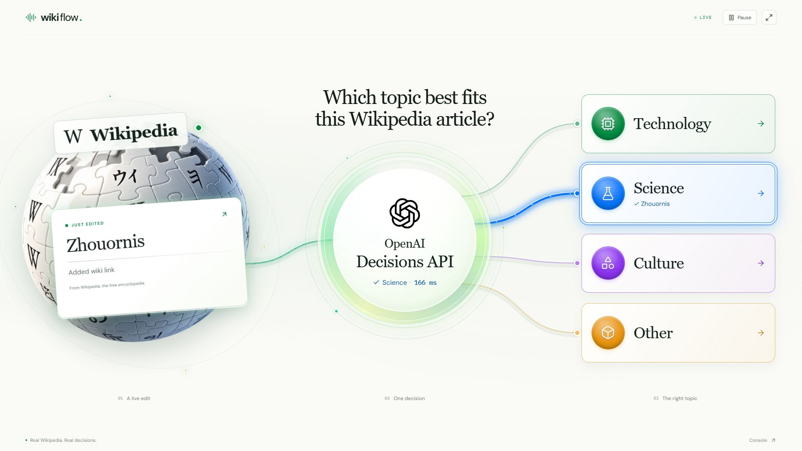

# WikiFlow

**The world edits. AI decides.**

Watch real Wikipedia edits flow through [OpenAI's Decisions API](https://developers.openai.com/api/docs/guides/decisions). A dimensional, animated scene sends each article to Technology, Science, Culture, or Other, using the actual API response.



## The idea

```text
Live Wikipedia edit → “Which topic?” → Decisions API answer → animated route
```

An article arrives from the Wikipedia globe and enters the OpenAI hub. The app requests its topic, then immediately lights the path returned by the API and sends the article to that category. The hub shows the actual choice and measured API round-trip time.

The detailed **[console](http://localhost:3000/console)** is also available, with confidence, latency, category probabilities, and an inspectable decision trail.

Built with **Next.js, React, TypeScript, SVG, and Motion**. The 2.5D presentation combines dimensional artwork with sharp, live interface elements and animated connections.

## Run locally

You need **Node.js 22+**, **npm 10+**, and your own OpenAI API key with access to the Decisions API. The app uses `gpt-6-luna`.

1. Clone or download this repository, open its directory, and install the locked dependencies:

   ```sh
   npm ci
   ```

2. Copy `.env.example` to `.env.local`:

   ```sh
   cp .env.example .env.local
   ```

   On Windows PowerShell, use `Copy-Item .env.example .env.local`.

3. Open `.env.local` and set your key:

   ```dotenv
   OPENAI_API_KEY=your-openai-api-key
   ```

4. Start the app:

   ```sh
   npm run dev
   ```

Open **[localhost:3000](http://localhost:3000)**. The live pipeline starts automatically. Restart the server after changing the environment file.

The presentation works without WebGL. The detailed console is available at `/console`.

The key stays on the server. `.env.local` is excluded from Git, and visitors running a clone supply their own key.

## Watch the decision happen

- **An edit arrives:** one real article travels from the globe into the decision hub.
- **OpenAI picks a topic:** the hub pulses while the actual request is pending.
- **The answer sets its path:** the chosen connection lights immediately and carries the article toward its category, which displays the same title.
- **See the speed:** the hub shows the measured server-to-OpenAI round trip in milliseconds.

The presentation starts a fresh edit about every three seconds when edits are available, with one request at a time. If a cycle takes longer, the next edit starts after it completes. It always selects the newest pending edit. It adds no hold after the API responds. Input and routing animations are separate from measured API latency. The console uses a five-second sampling interval and holds responses briefly for inspection.

Use **Pause / Resume** or **Space** to control the pipeline. Pause disconnects the feed and stops new API calls; a request already received by OpenAI may still finish. Use the fullscreen button for recording.

## How it works

| File | Responsibility |
| --- | --- |
| `src/app/api/stream/route.ts` | Proxies Wikimedia EventStreams, filters article edits, and falls back to polling actual recent changes. |
| `src/app/api/decide/route.ts` | Calls `POST /v1/decisions` from the server with one `choice` question. |
| `src/lib/decision-config.ts` | Shares the visible question with the real API instructions and defines presentation timing. |
| `src/lib/use-wiki-flow.ts` | Samples the feed and coordinates the input, request, response, and routing phases. |
| `src/components/wiki-presentation.tsx` | Connects the 2.5D scene, responsive SVG routes, controls, and live API answer to the pipeline. |
| `src/components/wiki-flow.tsx` | Renders the detailed console at `/console`. |

The feed includes non-bot article edits and new pages on English Wikipedia. Startup and fallback polling use actual recent changes. History stays in browser memory and resets on refresh. Topic distribution follows what people are editing, so some lanes may remain empty for a while.

The API classifies from the **article title and edit summary**. Latency measures the server-to-OpenAI request through receiving and parsing the complete response body. Animation time and browser-to-server time are excluded. Confidence and category probabilities are separate API fields.

## Commands

| Command | Purpose |
| --- | --- |
| `npm run dev` | Start the local development server. |
| `npm run typecheck` | Generate route types and check TypeScript. |
| `npm run build` | Create a production build. |
| `npm start` | Serve the production build locally. |

GitHub Actions runs the type check and production build on pull requests and pushes to `main`. These checks require no API key and make no live OpenAI calls.

## Scope

This is a local demo using your own OpenAI account. It has in-memory state and no sign-in or database. Add access controls and request limits before hosting the key-backed API routes for other people.

## Sources and license

- Live events: [Wikimedia EventStreams](https://wikitech.wikimedia.org/wiki/Event_Platform/EventStreams_HTTP_Service).
- Classification: [OpenAI Decisions API](https://developers.openai.com/api/docs/guides/decisions).
- Visual assets: an AI-generated globe illustration and the official OpenAI blossom; see [asset sources](public/images/README.md).
- Application source: [MIT](LICENSE). Wikipedia content and dependencies retain their respective licenses.
